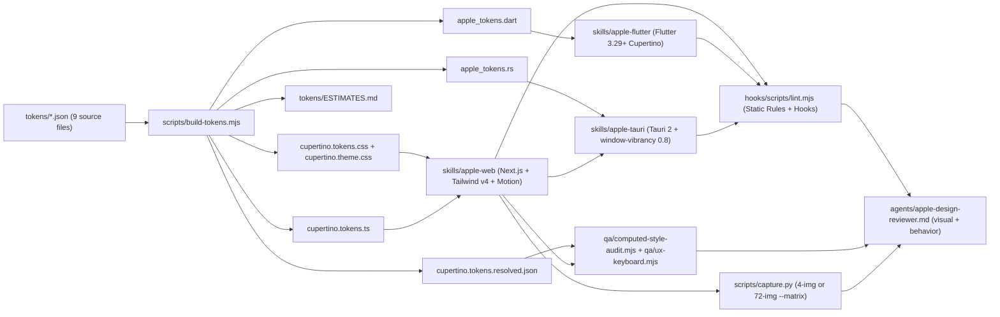

# cupertino-forge v2.2.0 — Complete Engineering Reference Manual

> **Audience:** Human engineers and AI coding agents (Claude Code, Google Antigravity, Cursor, Windsurf).
> When this manual and a source code/token file disagree, the source file wins. All paths, flags, exit codes, and code snippets below are verified directly against `cupertino-forge@2.2.0`.

---

## Table of Contents

1. [System Architecture & Data Flow Map](#1-system-architecture--data-flow-map)
2. [Complete Master Use-Flow (Human + AI Agent Playbook)](#2-complete-master-use-flow-human--ai-agent-playbook)
3. [Platform-by-Platform Integration Guide](#3-platform-by-platform-integration-guide)
4. [Complete CLI, Scripts & QA Reference](#4-complete-cli-scripts--qa-reference)
5. [Quality Gates (G1-G7), Scorecard & Reference Audit Workflow](#5-quality-gates-g1-g7-scorecard--reference-audit-workflow)
6. [Extending & Maintaining the Plugin](#6-extending--maintaining-the-plugin)
7. [Troubleshooting, Windows Gotchas & FAQ](#7-troubleshooting-windows-gotchas--faq)

---

## 1. System Architecture & Data Flow Map

### 1.1 End-to-End Pipeline



### 1.2 Honest Cross-Platform Parity Principle

- **Apple native platforms (iOS, iPadOS, macOS):** Native APIs (`NSGlassEffectView`, SwiftUI `ConcentricRectangle`, `UINotificationFeedbackGenerator`, native SF Pro) provide maximum parity.
- **Web, Flutter, and Tauri (Windows / Linux / MAS):** `cupertino-forge` encodes Apple's published HIG principles and Apple Design Resources kit measurements; closest parity on Apple platforms with native APIs; documented approximation elsewhere; 67 values remain estimates (see `tokens/ESTIMATES.md`). Never claim pixel-perfect parity across non-Apple platforms.

### 1.3 Token Provenance System (`tokens/*.json` & `tokens/ESTIMATES.md`)

Every token group carries explicit provenance metadata:

| Field | Allowed Values / Purpose |
|---|---|
| `$class` | `official` (Apple HIG DocC / SDK docs), `measured` (Apple iOS 27 / macOS 27 Sketch or Figma UI kits), `inferred` (derived from UIKit/SwiftUI behavior), `estimated` (not published numerically by Apple; tracked in `tokens/ESTIMATES.md`), `measured-kit-reference` (stored under `$kitReference` without overwriting cross-platform primary estimates), `inferred/community` (stored under `$alt`, e.g. `ScreenCorners` / `screens.guide`) |
| `$source` | Human-readable provenance citation (kit version, Figma node ID, or HIG page + date) |
| `$previous` | Preserves prior estimate value whenever a token is updated from Figma/kit measurements |
| `$alt` | Community SPI alternates kept separate from primary Apple kit tokens |
| `$kitConflict` | Recorded with `$status: "needs-device-verification"` when HIG and Sketch kit disagree (e.g., macOS `headline`/`caption1`/`caption2` weights in `tokens/typography.json`) |

`tokens/ESTIMATES.md` is auto-generated by `scripts/build-tokens.mjs --write-estimates tokens/ESTIMATES.md` (currently **67 estimated groups/entries** + **5 conflicts/alternates** after Phase 8B ForgeKit visible-surface sync). Every estimate-backed check or review remark must be tagged `estimate-based` and listed in the Compliance Report.

---

## 2. Complete Master Use-Flow (Human + AI Agent Playbook)

This section is synced 1:1 with [`skills/apple-design-core/references/workflows/use-flow.md`](skills/apple-design-core/references/workflows/use-flow.md).

### 2.1 Four Entry Scenarios (Serial Execution Order)

| Scenario | Trigger | Exact Serial Order |
|---|---|---|
| **A — Greenfield App** | New Web, Flutter, or Tauri project (no `.apple-design.json`) | 1. `/apple-doctor` -> 2. `/apple-init` (creates `.apple-design.json`, validates accent, runs `build-tokens.mjs`, copies primitives, installs IDE rules) -> 3. Read `SKILL.md` + `anti-patterns.md` + adapter `SKILL.md` -> 4. `/apple-screen` per screen -> 5. `/apple-component` only if catalog lacks a primitive -> 6. Quality Gates `G1`–`G7` -> 7. Print Compliance Report |
| **B — Existing Project Redesign** | Legacy generic / Material / Tailwind / shadcn app | 1. `/apple-doctor` -> 2. `/apple-init` (if `.apple-design.json` missing) -> 3. Read `patterns/redesign-playbook.md` + `00-principles.md` + `08-motion.md` + `anti-patterns.md` -> 4. Run `/apple-redesign` screen-by-screen (5-stage order below) -> 5. Run `/apple-audit` (`--reference <dir>` optional) -> 6. Fix all Blocking items (`< 85` = not done) -> 7. Print Compliance Report |
| **C — Single Screen or Component** | `.apple-design.json` already configured | 1. Confirm `.apple-design.json` -> 2. Read targeted specs via `SKILL.md` Section 2 router -> 3. `/apple-screen` or `/apple-component` -> 4. Quality Gates `G3`–`G7` -> 5. Print Compliance Report |
| **D1 — Token Update** | WWDC or Apple UI kit release | `/apple-sync` (`apple-spec-researcher` diff -> confirm -> update `tokens/*.json` + `15-version-diff.md` -> `build-tokens.mjs --write-estimates tokens/ESTIMATES.md` -> verify) |
| **D2 — Design Audit / Bugfix** | Checking or fixing an existing app | `/apple-audit [--reference <dir>]` (lint + `computed-style-audit.mjs` + `ux-keyboard.mjs` + `capture.py` + `apple-design-reviewer` -> `apple-audit-report.md`) |

### 2.2 Claude Code vs. Google Antigravity Execution Mapping

| Mechanism | Claude Code | Google Antigravity / Cross-IDE (`AGENTS.apple.md`) |
|---|---|---|
| **Path variable & auto-bootstrap** | `${CLAUDE_PLUGIN_ROOT}` (auto-resolved); `/apple-init` runs `scripts/setup-project.mjs --target .` | One-command `node "<PLUGIN_PATH>/scripts/setup-project.mjs" --target .` auto-resolves the exact plugin path into `.agent/rules/cupertino-forge.md` (no manual `<PLUGIN_PATH>` replacement needed) |
| **Session & prompt rules** | `templates/CLAUDE.apple.md` + `hooks/hooks.json` (`SessionStart`, `UserPromptSubmit`) | `.agent/rules/cupertino-forge.md` or `AGENTS.md` loaded automatically; start every session with `workflows/use-flow.md` |
| **Commands** | Slash commands (`/apple-init`, `/apple-screen`, `/apple-redesign`, `/apple-component`, `/apple-audit`, `/apple-doctor`, `/apple-sync`) | Open `<PLUGIN_PATH>/commands/<name>.md` and execute steps verbatim |
| **Post-edit lint** | Automatic `PostToolUse` hook (`lint.mjs --hook post`, blocks with exit `2`) | Manual terminal run after UI edits: `node "<PLUGIN_PATH>/hooks/scripts/lint.mjs" --all --root .` |
| **Pre-finish stop gate** | Automatic `Stop` hook (`lint.mjs --hook stop` on git-changed files) | Manual terminal verification of all applicable gates (`G1`–`G7`) before replying done |
| **Visual & behavior review** | `apple-design-reviewer` agent (`visual` + `behavior` modes) | Run `capture.py`, `computed-style-audit.mjs`, `ux-keyboard.mjs`, and follow `agents/apple-design-reviewer.md` checklist |

### 2.3 Brownfield Conversion in 5 Stages (`/apple-redesign` + `redesign-playbook.md`)

1. **Stage A — Tokens & Theme:** Create `.apple-design.json` from `templates/apple-design.json`, check custom accent with `contrast-check.mjs`, run `build-tokens.mjs`, and wrap the app root (`CupertinoRoot` + `CupertinoThemeScript`, `CfApp`, or Tauri `apply_apple_window`).
2. **Stage B — Deconstruction & IA:** Strip card-in-card nesting, decorative 1px borders, iOS content shadows, CTA clutter (`<= 1` prominent CTA per view), hamburger drawers, and web top navbars. Install native navigation (`TabBar` + `NavBar` on iOS; `MacWindow` + edge-to-edge `Sidebar` + unified `Toolbar` on macOS).
3. **Stage C — Liquid Glass & Continuous Shape:** Put Liquid Glass strictly on the functional layer (never on cards/rows, never glass-on-glass). Apply `Squircle` / `SquircleBorder` (`cornerSmoothing: 0.6` measured) and concentric radii (`inner = max(outer - padding, 4)`).
4. **Stage D — Motion, Haptics, States & Accessibility:** Replace `ease`/`linear` with `tokens/motion.json` springs, add 0ms pointer-down press states, wire haptics without stacking haptic+sound on toggles, add empty/loading (`>300ms` delay)/error states (`patterns/states.md`), and verify dark elevated surfaces, `contrast-more`, `reduced-transparency`, `reduced-motion`, Dynamic Type, and keyboard focus.
5. **Stage E — QA Audit:** Run `lint.mjs`, platform compiler/analyzer, `computed-style-audit.mjs`, `ux-keyboard.mjs`, and `apple-design-reviewer`.

---

## 3. Platform-by-Platform Integration Guide

### 3.1 `.apple-design.json` Project Config (`templates/apple-design.json`)

```json
{
  "platform": "web",
  "style": "adaptive",
  "accent": null,
  "appearance": "system",
  "glassIntensity": 0.5,
  "sounds": false,
  "haptics": true,
  "windowsChrome": "mac",
  "distribution": "direct",
  "tokensOut": "src/styles/cupertino",
  "appleRelease": "iOS 27 / macOS 27"
}
```

- `style: "adaptive"` switches by viewport width + pointer capability (`< 768` iOS, `768–1179` iPad, `>= 1180` + fine pointer macOS) — never by user-agent sniffing.
- `distribution` (Tauri macOS): `"direct"` enables `macOSPrivateApi: true` + `apply_liquid_glass`; `"mac-app-store"` disables private API and falls back to public `apply_vibrancy(Sidebar)`.

### 3.2 Web (Next.js / React + Tailwind v4 + shadcn/ui)

1. **Install dependencies:**
   ```bash
   npm i motion @radix-ui/react-dialog @radix-ui/react-popover @radix-ui/react-dropdown-menu @radix-ui/react-context-menu @radix-ui/react-switch @radix-ui/react-slider @radix-ui/react-tooltip @radix-ui/react-toggle-group clsx tailwind-merge lucide-react @phosphor-icons/react @fontsource-variable/inter
   ```
2. **Generate tokens & copy assets:**
   ```bash
   node "<PLUGIN_PATH>/scripts/build-tokens.mjs" --out src/styles/cupertino --targets css,tailwind,ts
   ```
   Copy `skills/apple-web/assets/lib/*` -> `src/lib/cupertino/`, `skills/apple-web/assets/components/apple/*` -> `src/components/apple/`, and `skills/apple-web/assets/styles/cupertino.base.css` -> `src/styles/cupertino/`.
3. **Import order in `src/app/globals.css`:**
   ```css
   @import "tailwindcss";
   @import "@fontsource-variable/inter";
   @import "../styles/cupertino/cupertino.tokens.css";
   @import "../styles/cupertino/cupertino.theme.css";
   @import "../styles/cupertino/cupertino.base.css";
   ```
4. **Zero-FOUC root layout (`src/app/layout.tsx`) — verified from `theme-script.ts` & `root.tsx`:**
   ```tsx
   import { CupertinoThemeScript } from '@/lib/cupertino/theme-script';
   import { CupertinoRoot } from '@/components/apple/root';

   export default function RootLayout({ children }: { children: React.ReactNode }) {
     return (
       <html lang="en" suppressHydrationWarning>
         <head>
           <meta name="viewport" content="width=device-width, initial-scale=1, viewport-fit=cover" />
           <CupertinoThemeScript />
         </head>
         <body>
           <CupertinoRoot style="adaptive" appearance="system" glassIntensity={0.5} sounds={false}>
             {children}
           </CupertinoRoot>
         </body>
       </html>
     );
   }
   ```
   `CupertinoThemeScript` injects `CF_THEME_INIT_SCRIPT` synchronously before first paint (setting `data-theme`, `data-contrast`, and `data-transparency`). `CupertinoRoot` wraps the tree in `<MotionConfig reducedMotion={reducedMotion ? 'always' : 'user'}>`, mounts `<TooltipPrimitive.Provider>`, exposes `setAppearance` / `setTransparency` / `setContrast` via `useCupertino()`, and tracks `prefers-reduced-motion`.
5. **Core Web Primitives (`src/components/apple/`):** `CupertinoRoot`, `Glass`, `GlassGroup`, `ScrollEdge`, `Squircle`, `Icon`, `Button`, `IconButton`, `NavBar`, `LargeTitle`, `BarButton`, `BarButtonGroup`, `Toolbar`, `ToolbarGroup`, `TabBar`, `List`, `ListSection`, `ListRow`, `SettingsIcon`, `Toggle`, `Slider`, `SegmentedControl`, `Stepper`, `TextField`, `SearchField`, `Sheet` (GPU `transform` drag + scroll-top handoff + focus return), `Alert` / `ConfirmationDialog` (focus return on `Esc`), `Menu`, `ContextMenu`, `Popover`, `Tooltip`, `ActivityIndicator`, `ProgressBar`, `Hud`, `EmptyState`, `MacWindow`, `TrafficLights`, `MacToolbar*`, `MacSidebar*`, `MacButton`, `Checkbox`, `RadioGroup`, `MacTextField`, `MacTable`.

### 3.3 Flutter (`skills/apple-flutter`)

1. **Generate Dart tokens & copy widgets:**
   ```bash
   node "<PLUGIN_PATH>/scripts/build-tokens.mjs" --out lib/apple_ui/theme --targets dart
   ```
   Copy `skills/apple-flutter/assets/lib/apple_ui/*` -> `lib/apple_ui/`. Never import `package:flutter/material.dart`.
2. **Root app (`lib/main.dart`) — verified from `cf_app.dart`:**
   ```dart
   import 'package:flutter/cupertino.dart';
   import 'apple_ui/cf_app.dart';
   import 'apple_ui/theme/apple_tokens.dart';

   void main() => runApp(const MyApp());

   class MyApp extends StatelessWidget {
     const MyApp({super.key});
     @override
     Widget build(BuildContext context) {
       return const CfApp(
         style: CfStyle.adaptive,
         accent: AppleSystemColors.blue,
         glassIntensity: 0.5,
         reduceTransparency: false,
         sounds: false,
         haptics: true,
         home: HomeScreen(),
       );
     }
   }
   ```
   `CfApp` applies `SystemChrome.setEnabledSystemUIMode(SystemUiMode.edgeToEdge)` once in `initState`, enforces single-pass Dynamic Type via `MediaQuery.withClampedTextScaling(maxScaleFactor: mac ? 1.0 : 3.1)` (`3.1` on iOS, `1.0` on macOS), and exposes `context.cf` / `CfScope`.
3. **Impeller `BackdropGroup` for sibling glass pills:** Wrap non-overlapping glass toolbar items in `BackdropGroup(child: ...)` and pass `CfGlass(grouped: true, ...)` so Impeller shares one backdrop pass (outer shadows remain unclipped outside `ClipPath`).
4. **Full Flutter Widget Catalog (`lib/apple_ui/`):** `CfApp`, `CfScope`, `CfElevated`, `SquircleBorder`, `CfSquircle`, `CfGlass`, `CfScrollEdge`, `animateSpring`, `CfPageRoute` (documented `CupertinoPageRoute` approximation), `CfScrollPhysics`, `CfPressable` (`PointerDeviceKind`), `CfHaptics`, `CfSounds`, `CfButton`, `CfIconButton`, `CfLargeTitleScaffold` (`ValueNotifier` scroll opacity), `CfBarButtonGroup`, `CfTabBar`, `CfList`, `CfListSection`, `CfListRow`, `CfSettingsIcon`, `CfToggle`, `CfSegmented`, `CfSlider`, `CfTextField`, `CfSearchField`, `CfMenuItem` / `showCfMenu` / `showCfPopover`, `CfActivityIndicator`, `CfProgressBar`, `showCfSheet`, `showCfAlert`.
5. **Native Haptics Plugins:**
   - **iOS:** Copy `skills/apple-flutter/assets/ios/AppleHapticsPlugin.swift` into `ios/Runner/` and register in `AppDelegate.swift` (`AppleHapticsPlugin.register(with: controller.binaryMessenger)`) for `UINotificationFeedbackGenerator` (`success`/`warning`/`error`) and `UIImpactFeedbackGenerator`.
   - **Android:** Copy `skills/apple-flutter/assets/android/AppleHapticsPlugin.kt` into `android/app/src/main/kotlin/<package>/` and register in `MainActivity`.

### 3.4 Tauri 2 + Rust (`skills/apple-tauri`)

Complete Web setup ([Section 3.2](#32-web-nextjs--react--tailwind-v4--shadcnui)) for the frontend, then configure the native Rust shell:

1. **Generate Rust tokens:**
   ```bash
   node "<PLUGIN_PATH>/scripts/build-tokens.mjs" --out src-tauri/src --targets rust
   ```
   Emits `apple_tokens.rs` (`WINDOW_CORNER_RADIUS: f64 = 16.0` measured in Apple Figma macOS 27 kit, traffic lights, sidebar/toolbar heights, colors).
2. **`src-tauri/Cargo.toml` (verified from `skills/apple-tauri/assets/Cargo-snippet.toml`):**
   ```toml
   [dependencies]
   tauri = { version = "2", features = ["macos-private-api"] } # direct only; for mac-app-store use: tauri = "2"
   window-vibrancy = "0.8" # LiquidGlassOptions::new(...).radius(...)
   tauri-plugin-window-state = "2"
   serde = { version = "1", features = ["derive"] }
   serde_json = "1"
   ```
3. **Config snippet by distribution:**
   - `"distribution": "direct"` -> merge `skills/apple-tauri/assets/tauri.conf.snippet.json` (`macOSPrivateApi: true`, `transparent: true`).
   - `"distribution": "mac-app-store"` -> merge `skills/apple-tauri/assets/tauri.conf.mas.snippet.json` (`macOSPrivateApi: false`, `transparent: false` — avoids Mac App Store private API rejection).
4. **Wire `src-tauri/src/lib.rs` (verified from `skills/apple-tauri/assets/src-tauri/src/lib-snippet.rs` & `skills/apple-tauri/assets/src-tauri/src/apple_window.rs`):**
   Copy `skills/apple-tauri/assets/src-tauri/src/apple_config.rs`, `skills/apple-tauri/assets/src-tauri/src/apple_menu.rs`, and `skills/apple-tauri/assets/src-tauri/src/apple_window.rs` into your project's `src-tauri/src/`. `lib.rs` loads `.apple-design.json` via `AppleDesignConfig::from_json(include_str!("../../.apple-design.json"))`, exposes `get_apple_design_config`, builds the native Menu Bar (`App`, `File`, `Edit`, `View`, `Window`, `Help` with dynamic `"Show Sidebar"` / `"Hide Sidebar"` toggling), and calls `apple_window::apply_apple_window(&win, cfg.inner())` (which uses `apply_liquid_glass` with `LiquidGlassOptions` in `Direct` mode, `apply_vibrancy(Sidebar)` in `MacAppStore` mode or macOS <= 15, and `apply_mica` on Windows 11).

---

## 4. Complete CLI, Scripts & QA Reference

Every command, flag, and exit code below was verified directly from the script source files:

### 4.1 `scripts/verify-plugin.mjs` (`/apple-doctor`)
- **Command:**
  ```bash
  node scripts/verify-plugin.mjs [--json]
  ```
- **Checks:** `.claude-plugin/plugin.json` manifest, `24/24` core runtime files (including `scripts/setup-project.mjs`), `9` token JSON schemas (`$meta`), all `${CLAUDE_PLUGIN_ROOT}/...` path references, `9` synthesized `.wav` assets, lint hook smoke test (`session` + `prompt`), token builder smoke test, and optional toolchain probes (`node`, `python` + Playwright, Node `qa/node_modules/playwright`, `flutter`, `cargo`).
- **Exit codes:** `0` = zero `FAIL` checks (missing optional toolchains report `NOT RUN`, never `FAIL`); `1` = 1+ `FAIL` checks.

### 4.2 `scripts/build-tokens.mjs`
- **Command:**
  ```bash
  node scripts/build-tokens.mjs --out <dir> [--targets css,tailwind,ts,dart,rust,json,estimates] [--tokens <tokensDir>] [--accent "#0088FF"] [--write-estimates <file>]
  ```
- **Defaults & Outputs:** Defaults to `--targets css,tailwind,ts,dart`, `--tokens <plugin>/tokens`, `--out <cwd>`. Emits `cupertino.tokens.css`, `cupertino.theme.css`, `cupertino.tokens.ts`, `apple_tokens.dart`, `apple_tokens.rs`, `cupertino.tokens.resolved.json`, and `ESTIMATES.md` (written to `--write-estimates` or `<out>/ESTIMATES.md`).
- **Exit codes:** `0` = success; non-zero on invalid JSON or color parse error.

### 4.3 `scripts/contrast-check.mjs`
- **Command:**
  ```bash
  node scripts/contrast-check.mjs [--accent "#0088FF"] [--accent-dark "#0091FF"] [--size 17] [--bold] [--strict-text]
  ```
- **Thresholds (Official Apple HIG Accessibility, WCAG 2.1/2.2 `0.04045` linearization):** `<= 17pt` regular text requires `4.5:1`; `>= 18pt`, `--bold`, or non-text glyphs require `3.0:1`. Auto-pairs known Apple system colors (`#0088FF` -> `#0091FF` dark) when `--accent-dark` is omitted. Supports `#RGB`, `#RRGGBB`, and `#RRGGBB@alpha`.
- **Exit codes:** `0` = zero blocking failures (and default no-arg audit mode without `--accent` exits `0`); `1` = invalid hex or 1+ blocking failures when `--accent` is supplied (small-text advisories become blocking only with `--strict-text`).

### 4.4 `scripts/capture.py`
- **Command:**
  ```bash
  # Standard (4 images: 390 & 1100 x light & dark, Chromium)
  python scripts/capture.py --url http://127.0.0.1:3000 --out qa/out

  # Full 72-image accessibility & cross-engine matrix (2 themes x 2 contrasts x 2 transparencies x 3 viewports x 3 engines)
  python scripts/capture.py --url http://127.0.0.1:3000 --matrix --out qa/out
  ```
- **Flags & Behavior:** `--url` (required), `--out` (default `qa/out`), `--matrix`, `--widths` (default `390,1100`), `--themes` (default `light,dark`), `--contrasts` (default `normal`; supports `normal,more`), `--transparencies` (default `normal`; supports `normal,reduce`), `--engines` (default `chromium`; supports `chromium,webkit,firefox`), `--chrome <path>`, `--full`, `--dry-run`, `--allow-over-100`. Prints exact planned count before launching browsers, logs missing engines as `NOT RUN (<engine>: <reason>)`, and applies `data-theme`/`data-contrast`/`data-transparency` plus CDP media emulation (`qa/out/` is gitignored).
- **Exit codes:** `0` = completed (missing engines reported `NOT RUN`); `2` = planned capture count exceeds 100 without `--allow-over-100`.

### 4.5 `scripts/pixel-diff.mjs` (Optional Legacy Helper)
- **Command:**
  ```bash
  node scripts/pixel-diff.mjs <ours.png> <reference.png> [--out diff.png] [--threshold 0.1]
  ```
- **Notes:** `/apple-audit --reference <dir>` intentionally uses **AI visual comparison** (not pixel-diff) because glass surfaces and estimated geometry produce noisy pixel deltas — see `qa/REFERENCE-WORKFLOW.md`.
- **Exit codes:** `0` = mismatch `<= 5%`; `2` = mismatch `> 5%`; `1` = missing CLI arguments.

### 4.6 `scripts/synth-sounds.py`
- **Command:**
  ```bash
  python scripts/synth-sounds.py [out_dir]
  ```
- **Behavior:** Defaults `out_dir` to `../assets/sounds` (requires `numpy`). Re-synthesizes all 9 original 44.1 kHz 16-bit mono WAV files (`tap`, `toggle-on`, `toggle-off`, `tick`, `success`, `error`, `send`, `refresh`, `keyboard`).
- **Exit codes:** `0` = all 9 WAV files written; non-zero if `numpy` is missing or write fails.

### 4.7 `scripts/package-plugin.mjs`
- **Command:**
  ```bash
  node scripts/package-plugin.mjs [--out <zipPath>]
  ```
- **Behavior:** Defaults output to `_upgrade/scratch/cupertino-forge-v<version>.zip`. Zero-dependency pure Node ZIP writer (CRC32 + Deflate, POSIX forward slashes). Packages **only** runtime allowlist (`.claude-plugin/`, `agents/`, `assets/`, `commands/`, `hooks/`, `qa/` excluding `node_modules`/`references`/`out`, `scripts/`, `skills/`, `templates/`, `tokens/`, `README.md`, `GUIDE.md`, `CHANGELOG.md`, `LICENSE` if present, `.gitattributes`). Strictly excludes `_upgrade/`, `_upgrade00-inputs/`, `.git/`, `tests/`, `node_modules/`, `dist/`, `build/`, `target/`, `.dart_tool/`, `qa/references/`, `qa/out/`, and `*.log`.
- **Exit codes:** `0` = clean package with `0` forbidden entries; `1` = forbidden entry detected.

### 4.8 `hooks/scripts/lint.mjs`
- **Command:**
  ```bash
  # CLI mode
  node hooks/scripts/lint.mjs [--all] [--root <dir>] [--json] [file1 file2 ...]

  # Hook mode (invoked automatically by Claude Code hooks/hooks.json via stdin JSON)
  node hooks/scripts/lint.mjs --hook session|prompt|post|stop
  ```
- **Behavior:** Only active in hook mode when `.apple-design.json` exists in or above the working directory. Add inline `cf-ignore` ONLY for justified cases (e.g., fixed macOS traffic-light colors) and list every exception in the Compliance Report.
- **Exit codes:** CLI mode: `0` (0 errors), `1` (1+ errors). Hook mode: `0` (pass / advisory warnings), `2` (`post` or `stop` blocking errors).

### 4.9 `qa/computed-style-audit.mjs`
- **Command:**
  ```bash
  node qa/computed-style-audit.mjs --url <url-or-file> [--tokens <resolved.json>] [--platform ios|macos] [--theme light|dark] [--accent "#0088FF"] [--json] [--out <file>]
  ```
- **Checks (12):** `font-size`, `letter-spacing`, `border-radius`, `spacing-grid`, `hit-target`, `contrast`, `glass-budget`, `glass-translucency`, `focus-ring`, `raw-color`, `easing`, `reduced-motion`. Reads all thresholds from `cupertino.tokens.resolved.json` (auto-built if `--tokens` omitted).
- **Exit codes:** `0` = 0 FAIL (may contain `NOT RUN`); `1` = 1+ FAIL; `2` = CLI usage or target load error.

### 4.10 `qa/ux-keyboard.mjs`
- **Command:**
  ```bash
  node qa/ux-keyboard.mjs --url <url-or-file> [--browser chromium|webkit|firefox|all] [--theme light|dark|both] [--json] [--out <file>]
  ```
- **Checks (6):** `no-positive-tabindex`, `tab-order-and-no-trap`, `focus-ring`, `modal-focus-trap-esc-return`, `roving-focus-ltr-rtl`, `enter-space-activation`. Missing browser engine reports `NOT RUN (<reason>)`.
- **Exit codes:** `0` = 0 FAIL (may contain `NOT RUN`); `1` = 1+ FAIL or runtime page load error; `2` = missing `--url` CLI usage error.

### 4.11 `scripts/setup-project.mjs` (Zero-Config Auto-Bootstrapper)
- **Command:**
  ```bash
  node scripts/setup-project.mjs --target <dir> [--platform ios|macos|adaptive|auto] [--mode new|redesign|auto] [--ide antigravity|claude|both] [--force] [--dry-run] [--json]
  ```
- **Behavior:** Auto-detects target stack (`web` via `package.json` with `next`/`react`/`react-dom`/`vite`, `flutter` via `pubspec.yaml`, or `tauri` via `src-tauri/Cargo.toml`) and mode (`new` vs `redesign` based on existing UI source files). Writes `.apple-design.json`, resolves its own absolute plugin path dynamically via `import.meta.url` to create `.agent/rules/cupertino-forge.md` (zero `<PLUGIN_PATH>` placeholders left behind) and/or safely append the `cupertino-forge` section to `CLAUDE.md` (idempotent; skips if already present), runs `scripts/build-tokens.mjs` through a temp staging directory, and copies adapter starter primitives. Never overwrites existing user files unless `--force` is passed; `--dry-run` simulates all file operations without modifying `--target`. Prints exact next-step handoff (`Scenario A` vs `Scenario B` in `workflows/use-flow.md`).
- **Exit codes:** `0` = bootstrap (or `--dry-run`) succeeded; `1` = runtime / token build failure; `2` = CLI usage error, missing target directory, or undetected/conflicting stack.

---

## 5. Quality Gates (G1-G7), Scorecard & Reference Audit Workflow

### 5.1 Blocking Quality Gates

| Gate | Command / Check | Blocks If... |
|---|---|---|
| **G1. Plugin Doctor** | `node scripts/verify-plugin.mjs` | Any check `FAIL` |
| **G2. Contrast** | `node scripts/contrast-check.mjs --accent "<hex>"` | Any blocking contrast failure |
| **G3. Static Lint** | `node hooks/scripts/lint.mjs --all --root .` | Exit `!= 0` |
| **G4. Build / Analyzer** | `tsc --noEmit` / `npm run build` / `flutter analyze && flutter test` / `cargo check` | Any compile, type, analyzer, or test failure |
| **G5. Runtime DOM Audit** | `node qa/computed-style-audit.mjs --url <url> --platform <ios\|macos>` | Any unaccepted `FAIL` |
| **G6. Keyboard UX** | `node qa/ux-keyboard.mjs --url <url> --browser all --theme both` | Any keyboard/focus `FAIL` |
| **G7. Design Review** | `apple-design-reviewer` (`visual` + `behavior`) or `/apple-audit` | Rule-Conformance `< 85` or unresolved `Blocking` item |

Any gate that cannot run MUST be reported as `NOT RUN (<exact reason>)` — never `PASS` or `OK`.

### 5.2 Two-Part Audit Scorecard & `--reference <dir>`

`/apple-audit` (`skills/apple-design-audit/SKILL.md` + `references/scorecard.md`) separates two independent scores:
- **Part A — Rule-Conformance (`0–100`):** 15 layers scored against Apple rules (`90+` Apple grade, `75–89` Close, `50–74` Apple-ish, `< 50` Not Apple).
- **Part B — Fidelity (`0–100` or `N/A (no reference)`):** Evaluated **only** when `/apple-audit --reference <dir>` points to a folder containing local PNG/JPG references (`design-kit-static` or `real-device`). When omitted or empty, the report MUST output `Fidelity: N/A (no reference)` with zero fidelity claims.

### 5.3 Two-Mode `apple-design-reviewer` (`agents/apple-design-reviewer.md`)

Invoke the single reviewer agent in either or both modes:
- **`visual` mode:** Reviews `qa/out/` screenshots against Apple structure, typography, color, material, shape, spacing, and icon rules; compares side-by-side (AI visual comparison) if `--reference <dir>` has images; tags estimate-backed remarks `estimate-based`.
- **`behavior` mode:** Reviews source code plus `computed-style-audit.mjs` and `ux-keyboard.mjs` outputs for states, keyboard/focus traps, roving focus, spring motion, haptics, and UX copy.

---

## 6. Extending & Maintaining the Plugin

1. **Editing or adding tokens:** Always edit `tokens/*.json` (never generated outputs), preserve `$class`/`$source`/`$url`/`$platform`, then rebuild the checked-in Flutter token asset (Web and Tauri token outputs are generated per target project / gitignored inside `tests/harness/`) and regenerate `tokens/ESTIMATES.md`:
   ```bash
   node scripts/build-tokens.mjs --out skills/apple-flutter/assets/lib/apple_ui/theme --targets dart --write-estimates tokens/ESTIMATES.md
   ```
   To also verify all targets locally in a scratch folder, pass `--out _upgrade/scratch/tokens-check --targets css,tailwind,ts,dart,rust,json,estimates`.
2. **Running the regression & harness suites:**
   ```bash
   node scripts/verify-plugin.mjs
   node --test tests/*.test.mjs
   ```
   Reproducible platform harnesses live in `tests/harness/{web,flutter,tauri}/` (see [`tests/harness/README.md`](tests/harness/README.md)) and seeded QA defect fixtures live in `tests/seeded-defects/`.
3. **Building a clean release ZIP:**
   ```bash
   node scripts/package-plugin.mjs
   # Produces _upgrade/scratch/cupertino-forge-v2.2.0.zip (162+ runtime files, 0 forbidden entries)
   ```

---

## 7. Troubleshooting, Windows Gotchas & FAQ

### 7.1 Windows-Specific Gotchas

- **`python` vs `python3`:** On Windows 11, `python3.exe` is often the Microsoft Store alias (exit `9009`). Always use `python` on Windows (`python3` on macOS/Linux).
- **Line endings (CRLF):** `.gitattributes` and `lint.mjs` normalize `\r?\n` and unquote `git status --porcelain` paths cleanly on Windows.
- **Playwright WebKit vs real Safari:** Playwright's Windows WebKit build verifies layout/DOM/CSS rules, but real macOS/iOS Safari renders native `SF Pro` and CoreAnimation compositing. Also note Python Playwright (`webkit-2104`/`firefox-1466`) and Node `qa/node_modules/playwright` (`webkit-2388`/`firefox-1572`) maintain separate browser revisions; missing binaries report `NOT RUN`.
- **macOS cross-compile limits:** Tauri `apply_liquid_glass` / `apply_vibrancy` branches are `#[cfg(target_os = "macos")]` and compile/run on macOS hosts; Windows `cargo check` / `cargo test --lib` validates shared Rust config, menu, tokens, and Windows Mica paths.

### 7.2 Common Errors & Fixes

| Symptom | Root Cause | Fix |
|---|---|---|
| `lint.mjs` blocks edits with exit `2` | Real Apple rule violation (raw hex, `rounded-md`, `ease-in-out`, off-scale font size, Material widget) | Replace with generated token or adapter primitive; use `cf-ignore` only for justified exceptions listed in the Compliance Report |
| `contrast-check.mjs` prints 3 `WARN` lines on `#0088FF` | Official Apple System Blue (`3.52:1` on white) is below `4.5:1` for `<=17pt` regular text | Expected advisory (`0 blocking failures`). Use filled white-on-accent capsules, `>=18pt`/bold text, or `lightHC`/`darkHC` variants for small accent text (see `qa/ACCESSIBILITY-TRADEOFFS.md`) |
| Mac App Store rejects Tauri build for private API | `"distribution": "direct"` enables `macOSPrivateApi: true` | Switch `.apple-design.json` to `"distribution": "mac-app-store"`, remove `"macos-private-api"` from `Cargo.toml`, and merge `skills/apple-tauri/assets/tauri.conf.mas.snippet.json` |
| Flutter text appears 2× oversized under Dynamic Type | Manual `MediaQuery.textScalerOf(context).scale(...)` called inside a widget | Remove manual scaling; `CfApp` + `CfType` apply single-pass `MediaQuery.withClampedTextScaling(maxScaleFactor: mac ? 1.0 : 3.1)` (`lint.mjs` flags manual `textScaler.scale(` as an error) |
| `ux-keyboard.mjs` reports WebKit/Firefox `NOT RUN` | Node Playwright (`qa/node_modules/playwright`) lacks matching browser binaries | Run `npx playwright install webkit firefox` inside `qa/`, or keep honest `NOT RUN` status in reports |
| `capture.py` fails on Windows with exit `9009` | Invoked `python3` (Windows Store alias) instead of `python` | Run `python scripts/capture.py ...` and ensure `pip install playwright` is installed |
| Glass looks opaque or flat | `prefers-reduced-transparency: reduce` or `data-transparency="reduce"` is active, or Firefox/Safari is rendering without Chromium SVG lens | Expected accessibility behavior in reduced-transparency mode; in normal mode on Firefox/Safari, blur + specular rim still render cleanly |
