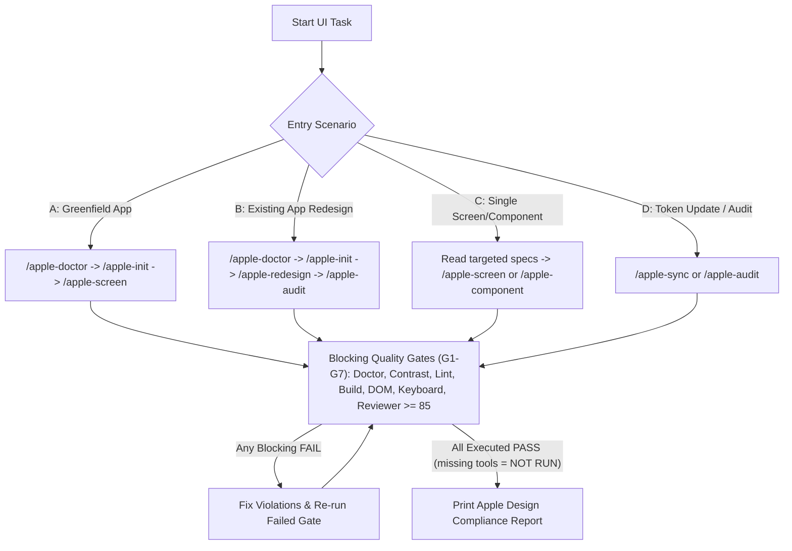

# cupertino-forge (v2.0.0)

**Apple iOS 27 & macOS 27 (Liquid Glass) Design System for Claude Code, Google Antigravity, and Cross-IDE Agentic Workflows.**

`cupertino-forge` turns Apple's Human Interface Guidelines (HIG) and iOS 27 / macOS 27 Sketch & Figma UI kit measurements into an enforceable token pipeline, ready-made cross-platform primitives, a brownfield Redesign Engine, a canonical Master Use-Flow, and deterministic Playwright/CLI quality gates.

> **Honest Parity Contract:** On Apple platforms (iOS, iPadOS, macOS), native APIs provide maximum platform parity. On Web (Next.js / React + Tailwind v4 + shadcn/ui), Flutter, and Tauri 2 (Windows / Linux / MAS), `cupertino-forge` delivers **documented visual approximation paired with 100% Apple design psychology, spatial hierarchy, motion discipline, and UX**.

---

## 1. Honest Cross-Platform Parity Matrix

| Capability | Apple Native (iOS / macOS) | Web (`apple-web`) | Flutter (`apple-flutter`) | Tauri 2 (`apple-tauri`) |
|---|---|---|---|---|
| **Liquid Glass & refraction** | **Native** (`NSGlassEffectView` / SwiftUI `.glassEffect`) | **Approximation** (`backdrop-filter` + rim sheen; SVG lens Chromium-only) | **Approximation** (`CfGlass` + Impeller `BackdropGroup`) | **Native** on macOS Direct (`window-vibrancy 0.8`); **Approximation** on macOS MAS (`apply_vibrancy`) & Windows Mica |
| **Continuous squircle corners (`0.6`)** | **Native** (`ConcentricRectangle` / `UICornerConfiguration`) | **Native** (`corner-shape: squircle` on Chrome 139+/Safari 18.4+/FF 148+) + SVG `mask-image` fallback | **Approximation / Native** (`SquircleBorder` / `ClipRSuperellipse`) | Native macOS window radius (`16pt` measured); Web `Squircle` inside webview |
| **System font (`SF Pro`) & tracking** | **Native** (`-apple-system` / system Cupertino font) | **Native** on Apple OS; **Approximation** (`Inter` variable + tracking compensation; `0em` for `bn`/`ar`/`he`) elsewhere | **Native** on iOS/macOS; **Approximation** (`Inter`) on Android/Win/Linux | **Native** on macOS `WKWebView`; **Approximation** (`Inter`) on Windows/Linux |
| **Spring motion & scroll inertia** | **Native** (`Spring` / `UIScrollView`) | **Approximation** (`motion/react` springs + sampled CSS `linear()` curves) | **Approximation** (`SpringSimulation` + `CfScrollPhysics`; `CfPageRoute` wraps `CupertinoPageRoute`) | Web `motion/react` inside webview |
| **Haptic feedback** | **Native** (`UINotificationFeedbackGenerator` / `UIImpactFeedbackGenerator`) | **Approximation** (Android `navigator.vibrate`, iOS Safari `<input switch>`); **Not possible** on Desktop | **Native** (`AppleHapticsPlugin.swift` iOS + `AppleHapticsPlugin.kt` Android); **Not possible** on Desktop | **Not possible** on Desktop (opt-in synthesized `.wav` sounds available) |
| **Reduce Transparency & High Contrast** | **Native** OS media / accessibility APIs | **Native** on Chromium; **In-app toggle** (`data-transparency="reduce"`, `data-contrast="more"`) required for Safari | **Approximation** (`CfApp(reduceTransparency: true)` + `highContrastOf`) | Handled via `CupertinoRoot` + OS theme sync |

---

## 2. Architecture & Repository Map

```text
cupertino-forge/
├── .claude-plugin/     Plugin manifest (plugin.json v2.0.0) & local marketplace.json
├── commands/           7 slash commands (doctor, init, screen, component, redesign, audit, sync)
├── agents/             2 specialist agents (apple-design-reviewer [visual|behavior], apple-spec-researcher)
├── skills/
│   ├── apple-design-core/   Brain: SKILL.md, 17 foundations, iOS/macOS specs, patterns, workflows/use-flow.md, extras/
│   ├── apple-web/           Next.js + Tailwind v4 + shadcn remap + 16 React primitives + 6 libs
│   ├── apple-flutter/       Cupertino-based Flutter 3.29+ primitives, SquircleBorder, CfGlass, iOS/Android haptics
│   ├── apple-tauri/         Tauri 2 Rust bridge (apple_config.rs, apple_window.rs, apple_menu.rs, MAS/Direct configs)
│   └── apple-design-audit/  Two-part audit skill (Rule-Conformance 0-100 + Fidelity) & 15-layer scorecard
├── tokens/             Single source of truth (9 JSON files + source/ kit exports + auto-generated ESTIMATES.md)
├── scripts/            Token builder, plugin doctor, contrast check, capture matrix, pixel-diff, sound synth, ZIP packager
├── qa/                 Playwright runtime DOM auditor (computed-style-audit.mjs), keyboard UX auditor (ux-keyboard.mjs), QA docs
├── hooks/              Claude Code hooks.json (SessionStart, UserPromptSubmit, PostToolUse, Stop) + lint.mjs
├── templates/          apple-design.json (template for .apple-design.json), CLAUDE.apple.md (Claude Code), AGENTS.apple.md (Google Antigravity)
├── assets/sounds/      9 original synthesized WAV UI sounds (zero Apple audio)
└── tests/              15 zero-dependency Node regression tests, seeded defect pages, & reproducible web/flutter/tauri harnesses
```

---

## 3. Dual-IDE Installation & Quickstart

### Prerequisites
- **Required:** Node.js `18+` (token generator, linter, doctor, packager, unit tests).
- **Optional (for runtime QA & platform harnesses):** Python `3` + `pip install playwright` (screenshot matrix & mounted verify), `npm install` inside `qa/` (Node Playwright for `computed-style-audit.mjs` & `ux-keyboard.mjs`), Flutter SDK `3.29+`, Rust `cargo` (Tauri 2). Missing optional tools report `NOT RUN (<reason>)`, never fake `PASS`.

### Option A — Claude Code (Automated Hooks + Slash Commands)

1. Build a clean release ZIP (optional if installing directly from clone):
   ```bash
   node scripts/package-plugin.mjs
   # Output: _upgrade/scratch/cupertino-forge-v2.0.0.zip
   ```
2. Unzip or keep the repository at a stable path (e.g., `D:\Claude-Plugins\cupertino-forge` or `~/cupertino-forge`).
3. Inside Claude Code:
   ```text
   /plugin marketplace add D:\Claude-Plugins\cupertino-forge
   /plugin install cupertino-forge@zerofounder-local
   ```
4. Restart Claude Code, then verify plugin health:
   ```text
   /apple-doctor
   ```
5. Inside any project root, run `/apple-init web ios` (or `flutter macos`, `tauri adaptive "#0088FF"`).

### Option B — Google Antigravity, Cursor, Windsurf & Generic Agentic IDEs (No Claude Hooks)

1. Clone or unzip `cupertino-forge` to a stable folder (e.g., `D:\Claude-Plugins\cupertino-forge`).
2. Copy [`templates/AGENTS.apple.md`](templates/AGENTS.apple.md) into your target project at:
   - `.agent/rules/cupertino-forge.md` (**Google Antigravity** workspace rule), or
   - `AGENTS.md` at the project root (generic agentic IDEs).
3. Replace `<PLUGIN_PATH>` inside that copied file with your local clone path, and copy [`templates/apple-design.json`](templates/apple-design.json) to `.apple-design.json` at the project root.
4. Run the manual terminal verification loop after UI edits (covers token generation plus Quality Gates G2, G3, G5, and G6; also run platform build G4 and visual/behavior review G7 per [`GUIDE.md`](GUIDE.md#5-quality-gates-g1-g7-scorecard--reference-audit-workflow)):
   ```bash
   node "<PLUGIN_PATH>/scripts/build-tokens.mjs" --out src/styles/cupertino --targets css,tailwind,ts
   node "<PLUGIN_PATH>/scripts/contrast-check.mjs" --accent "#0088FF"
   node "<PLUGIN_PATH>/hooks/scripts/lint.mjs" --all --root .
   node "<PLUGIN_PATH>/qa/computed-style-audit.mjs" --url http://127.0.0.1:3000 --platform ios
   node "<PLUGIN_PATH>/qa/ux-keyboard.mjs" --url http://127.0.0.1:3000 --browser all --theme both
   ```

---

## 4. Complete Command Cheat Sheet

| Command | When to Run | Arguments | Primary Output |
|---|---|---|---|
| `/apple-doctor` | First install or troubleshooting | `[--json]` | Health report (`PASS` / `NOT RUN` / `FAIL`) via `scripts/verify-plugin.mjs` |
| `/apple-init` | Once per project (greenfield or brownfield) | `[web\|flutter\|tauri] [ios\|macos\|adaptive] [accent hex]` | `.apple-design.json`, generated tokens, copied primitives, IDE rule block |
| `/apple-screen` | Building a full new screen | `<what the screen does>` | Complete screen with empty/loading/error states, QA gates, Compliance Report |
| `/apple-component` | Building or restyling one reusable component | `<component name and purpose>` | Spec-aligned component (all interaction states + a11y) + Compliance Report |
| `/apple-redesign` | Converting an existing generic/Material/shadcn app or screen | `[path, screen, or 'whole project'] [ios\|macos\|adaptive]` | Deconstruction plan, 5-stage conversion via `redesign-playbook.md`, QA + Compliance Report |
| `/apple-audit` | Auditing any existing UI | `[path or URL] [--reference <dir>]` | `apple-audit-report.md` with Rule-Conformance (`0–100`) & Fidelity (`N/A` unless `--reference` has images) |
| `/apple-sync` | After WWDC or a new Apple UI kit release | `[optional notes]` | Sourced token diff, updated `tokens/*.json` + `ESTIMATES.md` + `15-version-diff.md` |

---

## 5. Master Use-Flow & Quality Gates

Both Claude Code and Google Antigravity execute the single canonical workflow in [`skills/apple-design-core/references/workflows/use-flow.md`](skills/apple-design-core/references/workflows/use-flow.md):



---

## 6. Core Scripts & QA CLI Quick Reference

All flags below are verified directly from the script source files:

```bash
# Plugin doctor & toolchain probe
node scripts/verify-plugin.mjs [--json]

# Generate platform tokens (CSS, Tailwind v4, TS, Dart, Rust, Resolved JSON, ESTIMATES.md)
node scripts/build-tokens.mjs --out <dir> --targets css,tailwind,ts,dart,rust,json,estimates [--accent "#0088FF"] [--write-estimates tokens/ESTIMATES.md]

# HIG Accessibility contrast validation (4.5:1 <=17pt regular; 3:1 >=18pt/bold/glyph)
node scripts/contrast-check.mjs --accent "#0088FF" [--accent-dark "#0091FF"] [--size 17] [--bold] [--strict-text]

# Static design linter (web + Dart rules; exit 1 on errors)
node hooks/scripts/lint.mjs --all --root . [--json]

# Runtime Playwright computed-style DOM audit (12 checks)
node qa/computed-style-audit.mjs --url <url-or-file> [--platform ios|macos] [--theme light|dark] [--accent "#0088FF"] [--json] [--out <file>]

# Runtime Playwright keyboard & focus accessibility audit (6 checks)
node qa/ux-keyboard.mjs --url <url-or-file> [--browser chromium|webkit|firefox|all] [--theme light|dark|both] [--json] [--out <file>]

# Screenshot capture (standard 4 images or --matrix 72-image accessibility/engine matrix)
python scripts/capture.py --url <url> --out qa/out [--matrix] [--widths 390,1100] [--themes light,dark] [--dry-run]

# Build clean v2.0.0 release ZIP (0 forbidden folders)
node scripts/package-plugin.mjs [--out <zipPath>]
```

---

## 7. Legal, Licensing & Known Limitations

- **Zero Apple assets redistributed:** `cupertino-forge` does **not** ship Apple `.sketch`/`.fig` kits, exported Apple PNGs, hardware bezels, SF font files, SF Symbols, or Apple system audio.
- **System fonts & icons:** Apple devices legally invoke San Francisco via system stacks; non-Apple platforms use `Inter` (OFL) with automatic tracking compensation (disabled for Bangla/Arabic/Hebrew). Icons map to Lucide, Phosphor, or `CupertinoIcons`.
- **Brand-constrained buttons:** Apple Pay, Tap to Pay on iPhone, Add to Apple Wallet, and Sign in with Apple must always use official Apple SDKs/APIs (`skills/apple-design-core/references/extras/brand-constrained.md`).
- **Remaining estimates & physical device checks:** `70` token groups in [`tokens/ESTIMATES.md`](tokens/ESTIMATES.md) remain `$class: "estimated"` (runtime physics, blur sigmas, haptics/sounds, and multi-size ambiguous kit controls). Real iPhone/Mac hardware verification is still recommended for live `NSGlassEffectView` refraction, `UINotificationFeedbackGenerator` feel, and macOS font-weight conflicts (`$kitConflict`).
- **Reference Fidelity:** `/apple-audit --reference <dir>` runs in AI visual-comparison mode when local PNGs exist; without references, it reports `Fidelity: N/A (no reference)`.

---

## 8. Deep-Dive Engineering Manual

For the full architecture diagram, token provenance rules, copy-paste Next.js / Flutter / Tauri 2 integration code, every script flag & exit code, Windows-specific gotchas, harness instructions, and troubleshooting FAQ, read **[`GUIDE.md`](GUIDE.md)**.
