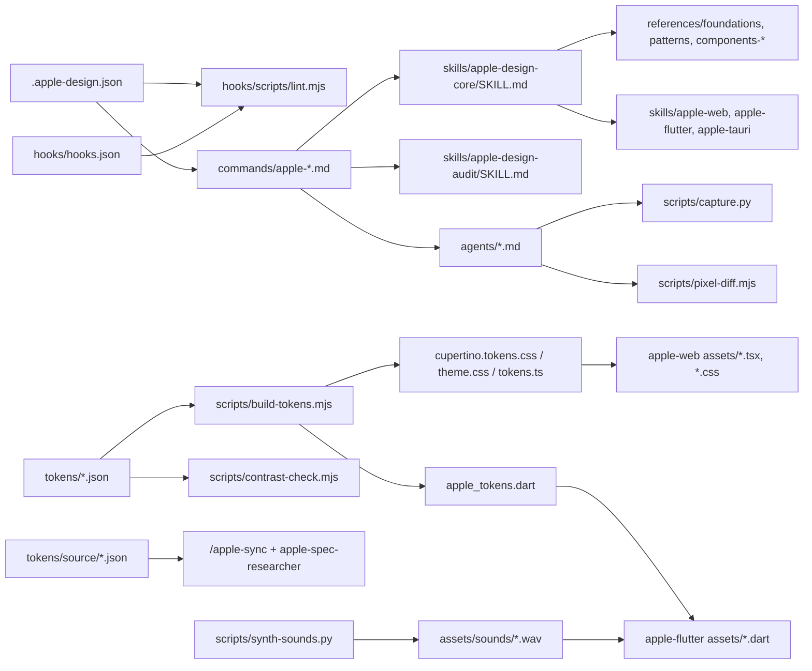

# cupertino-forge — Plugin Map, Complete Inventory & Dependency Audit

তারিখ: ২৫ নভেম্বর ২০২৬ · Workspace Root: `D:\Claude-Plugins\cupertino-forge`
পদ্ধতি: সরাসরি ফাইল পাঠ, স্ট্রাকচারাল JSON পরিদর্শন, Node/Python স্ক্র্যাচ টেস্ট (`_upgrade\scratch\`)। কোনো plugin ফাইল পরিবর্তন করা হয়নি।

> **নোট (Input ফোল্ডার):** নির্দেশনায় `_upgrade\00-inputs\` উল্লেখ থাকলেও প্রকৃত workspace-এ ফোল্ডারটির নাম `_upgrade00-inputs\` (`chatGPT-enhanced-prompt.md` এবং `cupertino-forge — Audit, Gap Analysis ও Upgrade Blueprint.md`)।

---

## ১. Executive Reality Check: আগের Audit-এর #1 দাবি বনাম বাস্তবতা

আগের Audit (`cupertino-forge — Audit, Gap Analysis ও Upgrade Blueprint.md`, §১ ও A1) দাবি করেছিল যে ইনস্টল করা কপিতে শুধু `skills/` আছে (৮২টি ফাইল) এবং `tokens/*.json`, `scripts/*`, `hooks/*`, `agents/*`, `templates/*`, `assets/sounds/*`, `.claude-plugin/*` অনুপস্থিত।

**বর্তমান Workspace-এর বাস্তবতা (`Measured` + `Tested`):**
- এই workspace (`D:\Claude-Plugins\cupertino-forge`) হলো **সম্পূর্ণ plugin repository**। এতে মোট **১২০টি plugin ফাইল** (ও ১টি খালি ফোল্ডার `skills/apple-tauri/references/`) এবং `_upgrade00-inputs/`-এ ২টি ইনপুট ফাইল রয়েছে।
- আগের Audit-এ যেসব runtime অংশ অনুপস্থিত বলা হয়েছিল, **তার সবগুলোই এই workspace-এ বিদ্যমান এবং স্ক্র্যাচ টেস্টে সচল প্রমাণিত হয়েছে**:
  - `.claude-plugin/plugin.json` ও `marketplace.json` — আছে।
  - `tokens/*.json` (৯টি মূল ফাইল + `tokens/source/`-এ ২টি raw Apple Sketch kit export) — আছে।
  - `scripts/` (`build-tokens.mjs`, `capture.py`, `contrast-check.mjs`, `pixel-diff.mjs`, `synth-sounds.py`) — আছে।
  - `hooks/hooks.json` ও `hooks/scripts/lint.mjs` — আছে।
  - `agents/` (`apple-design-reviewer.md`, `apple-spec-researcher.md`) — আছে।
  - `commands/` (`apple-init.md`, `apple-screen.md`, `apple-component.md`, `apple-audit.md`, `apple-sync.md`) — আছে।
  - `templates/` (`apple-design.json`, `CLAUDE.apple.md`) — আছে।
  - `assets/sounds/` (৯টি `.wav` ফাইল) — আছে।
- **কেন আগের Audit-এ মিস হয়েছিল?** Claude Code-এর skill-only export/cache ফ্ল্যাট কপিতে শুধু `skills/` ও `commands/`-কে skill হিসেবে দেখিয়েছিল (`82` files); কিন্তু মূল plugin repo-তে পুরো ৪-স্তরীয় runtime বিদ্যমান।

---

## ২. পুরো Workspace Inventory (সব ১২২টি ফাইল)

- **Line Endings (`Measured`):** Plugin-এর ১০৯টি টেক্সট ফাইলের সবগুলোই **LF** (`crlfCount: 0`, `mixedCount: 0`), যা `.gitattributes` (`* text=auto`) দ্বারা নিয়ন্ত্রিত। বাকি ১১টি ফাইল হলো ৯টি বাইনারি `.wav` এবং ২টি বৃহৎ raw kit JSON (সব LF)।
- **Empty Directory:** `skills/apple-tauri/references/` (১টি খালি ফোল্ডার)।

### ২.১ Root ও `.claude-plugin`

| Path | Size (B) | Lines | Role |
|---|---:|---:|---|
| `.gitattributes` | 66 | 2 | Text file LF normalization rule (`* text=auto`) |
| `README.md` | 3,434 | 40 | সংক্ষিপ্ত পরিচিতি, Windows/macOS/Linux install ও verification status |
| `GUIDE.md` | 34,069 | 489 | পূর্ণ installation, usage, lint rules, tokens, adapters ও cheat sheet গাইড |
| `.claude-plugin/plugin.json` | 530 | 8 | Claude Code plugin manifest (`cupertino-forge`, `v1.0.0`, MIT) |
| `.claude-plugin/marketplace.json` | 346 | 14 | Local marketplace `zerofounder-local` manifest (`source: "./"`) |

### ২.২ Agents, Commands, Hooks, Scripts, Templates, Assets

| Path | Size (B) | Lines | Role |
|---|---:|---:|---|
| `agents/apple-design-reviewer.md` | 3,378 | 41 | ১০-দফা visual/code review subagent (৮৫+ স্কোর পাস গেট) |
| `agents/apple-spec-researcher.md` | 2,134 | 20 | `/apple-sync` এর জন্য WWDC/HIG/UI kit diff গবেষণা subagent |
| `commands/apple-init.md` | 2,012 | 16 | `/apple-init` — stack detect, `.apple-design.json`, accent contrast ও adapter setup |
| `commands/apple-screen.md` | 1,370 | 14 | `/apple-screen` — `screens.md` ও `states.md` মেনে পূর্ণ স্ক্রিন নির্মাণ |
| `commands/apple-component.md` | 970 | 13 | `/apple-component` — spec-অনুযায়ী একক component তৈরি বা restyle |
| `commands/apple-audit.md` | 1,068 | 12 | `/apple-audit` — static + structural + visual pass করে `apple-audit-report.md` তৈরি |
| `commands/apple-sync.md` | 1,029 | 11 | `/apple-sync` — Apple kit আপডেট diff করে token ও generated ফাইল rebuild |
| `hooks/hooks.json` | 844 | 17 | `SessionStart`, `UserPromptSubmit`, `PostToolUse`, `Stop` হুক সংজ্ঞা |
| `hooks/scripts/lint.mjs` | 14,445 | 193 | ১৮টি Web + ১০টি Dart লিন্ট নিয়ম ও ৪টি Claude hook হ্যান্ডলার |
| `scripts/build-tokens.mjs` | 26,662 | 419 | `tokens/*.json` → CSS, Tailwind v4 `@theme`, TS (`cf`, `spring`), Dart (`apple_tokens.dart`) |
| `scripts/capture.py` | 2,436 | 45 | Playwright দিয়ে `390,1100` প্রস্থে `light,dark` স্ক্রিনশট ক্যাপচার |
| `scripts/contrast-check.mjs` | 2,511 | 33 | WCAG 2.0 কনট্রাস্ট যাচাই (default tokens বা `--accent #RRGGBB`) |
| `scripts/pixel-diff.mjs` | 2,087 | 32 | `pixelmatch` + `pngjs` দিয়ে স্ক্রিনশট বনাম Apple reference তুলনা |
| `scripts/synth-sounds.py` | 3,188 | 68 | `numpy` দিয়ে ৯টি মূল UI সাউন্ড `.wav` ফাইল সংশ্লেষণ |
| `templates/apple-design.json` | 354 | 13 | প্রজেক্ট রুট কনফিগ `.apple-design.json` টেমপ্লেট |
| `templates/CLAUDE.apple.md` | 1,055 | 8 | `/apple-init`-এ প্রজেক্টের `CLAUDE.md`-তে যোগ হওয়া বাধ্যতামূলক নিয়ম ব্লক |
| `assets/sounds/error.wav` | 28,268 | 0 | Original UI sound: 1ch, 16-bit, 44.1kHz, 320.0ms (measured) |
| `assets/sounds/keyboard.wav` | 2,690 | 0 | Original UI sound: 1ch, 16-bit, 44.1kHz, 30.0ms (measured) |
| `assets/sounds/refresh.wav` | 5,336 | 0 | Original UI sound: 1ch, 16-bit, 44.1kHz, 60.0ms (measured) |
| `assets/sounds/send.wav` | 30,032 | 0 | Original UI sound: 1ch, 16-bit, 44.1kHz, 340.0ms (measured) |
| `assets/sounds/success.wav` | 35,324 | 0 | Original UI sound: 1ch, 16-bit, 44.1kHz, 400.0ms (measured) |
| `assets/sounds/tap.wav` | 5,336 | 0 | Original UI sound: 1ch, 16-bit, 44.1kHz, 60.0ms (measured) |
| `assets/sounds/tick.wav` | 2,690 | 0 | Original UI sound: 1ch, 16-bit, 44.1kHz, 30.0ms (measured) |
| `assets/sounds/toggle-off.wav` | 7,982 | 0 | Original UI sound: 1ch, 16-bit, 44.1kHz, 90.0ms (measured) |
| `assets/sounds/toggle-on.wav` | 7,982 | 0 | Original UI sound: 1ch, 16-bit, 44.1kHz, 90.0ms (measured) |

### ২.৩ Tokens (`tokens/*.json` ও `tokens/source/`)

| Path | Size (B) | Lines | Role |
|---|---:|---:|---|
| `tokens/color.json` | 12,359 | 206 | System colors, vibrant, grays, labels, fills, backgrounds, macOS surfaces/controls, focus ring |
| `tokens/elevation.json` | 2,913 | 27 | Shadow levels (knob, sliderKnob, raised, popover, menu, panel, windows, sheet, toast) |
| `tokens/feedback.json` | 5,877 | 55 | Platform haptic matrix (iOS/Android/Flutter/Web) ও ৯টি synthesized sound spec |
| `tokens/icons.json` | 8,165 | 92 | SF Symbol → Lucide / Phosphor / CupertinoIcons ম্যাপ ও stroke-weight নিয়ম |
| `tokens/layout.json` | 6,122 | 80 | 4pt spacing, hit target, iOS/macOS metrics, breakpoints, z-index |
| `tokens/materials.json` | 15,307 | 334 | Liquid Glass raw kit stacks + tuned CSS recipes + standard materials |
| `tokens/motion.json` | 6,444 | 221 | WWDC23 spring model, ১১টি spring token, transitions, press, hover, scroll physics |
| `tokens/shape.json` | 3,960 | 103 | Continuous corner smoothing (0.6), concentric formula, iOS & macOS radius tables |
| `tokens/typography.json` | 31,462 | 1,481 | Font stacks, Inter compensation, iOS Dynamic Type (xSmall..AX5), macOS styles, tracking tables |
| `tokens/source/apple-ios-27-ui-kit.tokens.json` | 235,703 | 10,398 | Raw Sketch DTCG export (৪০২ token: ২৭১ color, ১০৫ typography, ৫ border, ২০ shadow, ১ gradient) |
| `tokens/source/apple-macos-27-ui-kit.tokens.json` | 373,015 | 15,671 | Raw Sketch DTCG export (৬৭৬ token: ৫৪৪ color, ৬৭ typography, ১৮ border, ৪৬ shadow, ১ gradient) |

### ২.৪ Skills: `apple-design-core` ও `apple-design-audit`

| Path | Size (B) | Lines | Role |
|---|---:|---:|---|
| `skills/apple-design-audit/SKILL.md` | 1,606 | 27 | ৪-ধাপের audit প্রক্রিয়া ও `apple-audit-report.md` ফরম্যাট |
| `skills/apple-design-audit/references/scorecard.md` | 1,919 | 19 | ১৫-স্তরের (০–১০) স্কোরকার্ড রুব্রিক (`sum / 150 * 100`) |
| `skills/apple-design-core/SKILL.md` | 12,229 | 116 | মূল brain: contract, mental model, router, ২৫ golden rules, DoD, Compliance Report |
| `skills/apple-design-core/references/anti-patterns.md` | 3,805 | 42 | ৩৭টি instant-fail anti-pattern ও সমাধান (lint-চিহ্নিতগুলোসহ) |
| `skills/apple-design-core/references/patterns/screens.md` | 4,266 | 28 | ১২টি স্ক্রিন রেসিপি (Settings, Onboarding, Sign in, List-detail, Chat, Desktop shell...) |
| `skills/apple-design-core/references/patterns/states.md` | 2,474 | 28 | Empty, Loading, Error, Offline, Permission, Success, Destructive state spec |
| `skills/apple-design-core/references/foundations/00-principles.md` | 3,074 | 35 | ৪টি নকশা প্রশ্ন, hierarchy, deference, depth, feedback সিদ্ধান্ত প্রক্রিয়া |
| `skills/apple-design-core/references/foundations/01-layout.md` | 4,039 | 74 | 4pt grid, iOS/iPadOS/macOS metrics, size-class breakpoints ও ASCII skeleton |
| `skills/apple-design-core/references/foundations/02-typography.md` | 4,511 | 66 | iOS/macOS style table, element mapping, Inter compensation ও Dynamic Type নিয়ম |
| `skills/apple-design-core/references/foundations/03-color.md` | 3,992 | 45 | Semantic color তালিকা, background elevation levels, accent ও contrast নিয়ম |
| `skills/apple-design-core/references/foundations/04-liquid-glass.md` | 4,053 | 34 | Functional vs content layer, ৫টি variant, scroll edge, lens refraction ও fallback |
| `skills/apple-design-core/references/foundations/05-shape.md` | 3,293 | 32 | Continuous corners, concentric math, iOS/macOS radius table ও separator নিয়ম |
| `skills/apple-design-core/references/foundations/06-elevation.md` | 1,886 | 32 | ৮-স্তরের z-index stack, shadow levels ও dark-mode elevated surface নিয়ম |
| `skills/apple-design-core/references/foundations/07-iconography.md` | 2,277 | 22 | SF Symbol metaphor-first নিয়ম, stroke width, settings icon, symbol effects |
| `skills/apple-design-core/references/foundations/08-motion.md` | 3,731 | 46 | Spring physics সূত্র, ১১টি spring token, transitions catalog, gestures, reduced motion |
| `skills/apple-design-core/references/foundations/09-interaction-states.md` | 2,955 | 29 | Pressed, hover, focus ring, disabled, selected state matrix ও cursor নিয়ম |
| `skills/apple-design-core/references/foundations/10-haptics-sound.md` | 2,428 | 30 | Haptic mapping, opt-in sound নীতি ও event-throttling নিয়ম |
| `skills/apple-design-core/references/foundations/11-accessibility.md` | 2,315 | 30 | Dark/HC/RT/RM/Dynamic Type সিগন্যাল, WCAG থ্রেশহোল্ড, keyboard ও RTL |
| `skills/apple-design-core/references/foundations/12-ux-writing.md` | 2,262 | 28 | Apple voice, Title/Sentence case, button verbs, alerts, Bangla 20–30% expansion |
| `skills/apple-design-core/references/foundations/13-dark-mode.md` | 1,424 | 16 | Dark base vs elevated surfaces, image dimming, appearance switching |
| `skills/apple-design-core/references/foundations/14-licensing-fallbacks.md` | 2,218 | 25 | SF/SF Symbols/Apple Audio licensing ও ৬-প্ল্যাটফর্ম fidelity matrix |
| `skills/apple-design-core/references/foundations/15-version-diff.md` | 2,380 | 21 | iOS 27 / macOS 27 Golden Gate পরিবর্তন ও legacy (iOS 18/Tahoe) বর্জন তালিকা |
| `skills/apple-design-core/references/components-ios/navigation.md` | 4,395 | 44 | iOS NavBar, TabBar, Toolbar, Search, iPad Sidebar, navigation patterns |
| `skills/apple-design-core/references/components-ios/controls.md` | 4,989 | 65 | iOS Button, Toggle, Slider, Segmented, Stepper, Picker, TextField, Progress, Badge |
| `skills/apple-design-core/references/components-ios/presentation.md` | 3,158 | 37 | iOS Sheet, Alert, ConfirmationDialog, Menu, ContextMenu, Popover, Hud |
| `skills/apple-design-core/references/components-ios/content.md` | 3,110 | 35 | iOS List, SwipeActions, Grid, Card, PageControl, Disclosure, Charts, Avatars |
| `skills/apple-design-core/references/components-macos/window-chrome.md` | 2,505 | 22 | macOS Window, TrafficLights, Titlebar/Unified Toolbar, Fullscreen, Menu bar, Settings |
| `skills/apple-design-core/references/components-macos/navigation.md` | 2,434 | 26 | macOS Edge-to-edge Sidebar, Toolbar, Tabs, Split view, Inspector |
| `skills/apple-design-core/references/components-macos/controls.md` | 3,574 | 45 | macOS Push button, Popup/Pulldown, Checkbox, Radio, Switch, Segmented, Slider, Field |
| `skills/apple-design-core/references/components-macos/presentation.md` | 2,176 | 23 | macOS Menu, Popover, Sheet, Alert, Tooltip, Notifications, Panels |
| `skills/apple-design-core/references/components-macos/content.md` | 1,589 | 17 | macOS Table/List, Outline view, Collection grid, Settings forms, density |

### ২.৫ Adapters (`apple-web`, `apple-flutter`, `apple-tauri`)

| Path | Size (B) | Lines | Role |
|---|---:|---:|---|
| `skills/apple-web/SKILL.md` | 6,543 | 68 | Web adapter গাইড (Next.js + Tailwind v4 + shadcn remap + Motion + Radix) |
| `skills/apple-web/references/components-web.md` | 5,849 | 93 | Web primitiveগুলোর props ও usage উদাহরণ |
| `skills/apple-web/assets/styles/cupertino.base.css` | 6,947 | 132 | shadcn remap, base typography, Inter compensation, `.cf-glass`, scroll edge, press states |
| `skills/apple-web/assets/lib/cn.ts` | 519 | 10 | `clsx` + `extendTailwindMerge` (`cfText` font-size group) |
| `skills/apple-web/assets/lib/haptics.ts` | 2,260 | 44 | Web haptics (Android `vibrate`, iOS Safari 18+ `<input switch>` trick, desktop no-op) |
| `skills/apple-web/assets/lib/platform.ts` | 1,141 | 24 | `resolvePlatform`, `isApplePlatform`, `sizeClass`, `modKeyLabel` |
| `skills/apple-web/assets/lib/sounds.ts` | 3,713 | 77 | Web Audio API দ্বারা ৯টি UI সাউন্ড রিয়েল-টাইম সংশ্লেষণ (opt-in) |
| `skills/apple-web/assets/lib/squircle.ts` | 2,514 | 49 | Figma corner-smoothing (0.6) SVG path জেনারেটর ও `supportsCornerShape()` |
| `skills/apple-web/assets/components/apple/root.tsx` | 4,692 | 91 | `CupertinoRoot`, `useCupertino`, `LensFilter` SVG displacement map |
| `skills/apple-web/assets/components/apple/glass.tsx` | 2,533 | 59 | `Glass`, `GlassGroup`, `ScrollEdge` |
| `skills/apple-web/assets/components/apple/squircle.tsx` | 1,793 | 43 | `Squircle` wrapper (`ResizeObserver` + `clipPath` fallback) |
| `skills/apple-web/assets/components/apple/icon.tsx` | 1,192 | 30 | `Icon` wrapper (Lucide size & strokeWeight mapping) |
| `skills/apple-web/assets/components/apple/button.tsx` | 4,407 | 103 | `Button` (8 variants, 5 sizes, extended hit area) ও `IconButton` |
| `skills/apple-web/assets/components/apple/nav.tsx` | 4,233 | 91 | `NavBar`, `LargeTitle`, `BarButtonGroup`, `BarButton`, `Toolbar`, `ToolbarGroup` |
| `skills/apple-web/assets/components/apple/tab-bar.tsx` | 3,246 | 62 | `TabBar` (minimize-on-scroll, search button, `layoutId` pill) |
| `skills/apple-web/assets/components/apple/list.tsx` | 4,862 | 88 | `List`, `ListSection`, `ListRow`, `SettingsIcon` |
| `skills/apple-web/assets/components/apple/controls.tsx` | 6,812 | 116 | `Toggle`, `Slider`, `SegmentedControl`, `Stepper` |
| `skills/apple-web/assets/components/apple/fields.tsx` | 4,014 | 72 | `TextField`, `SearchField` |
| `skills/apple-web/assets/components/apple/sheet.tsx` | 4,300 | 78 | `Sheet` (`medium`/`large` detent, header drag, Radix Dialog) |
| `skills/apple-web/assets/components/apple/alert.tsx` | 6,143 | 94 | `Alert`, `ConfirmationDialog` |
| `skills/apple-web/assets/components/apple/menu.tsx` | 5,288 | 101 | `Menu`, `MenuItem`, `MenuSection`, `SubMenu`, `ContextMenu` |
| `skills/apple-web/assets/components/apple/popover.tsx` | 1,996 | 46 | `Popover`, `Tooltip` |
| `skills/apple-web/assets/components/apple/feedback.tsx` | 3,634 | 69 | `ActivityIndicator`, `useDelayedFlag`, `ProgressBar`, `Hud`, `EmptyState` |
| `skills/apple-web/assets/components/apple/mac.tsx` | 11,964 | 194 | `MacWindow`, `TrafficLights`, `MacToolbar*`, `MacSidebar*`, `MacButton`, `Checkbox`, `RadioGroup`, `MacTextField`, `MacTable` |
| `skills/apple-flutter/SKILL.md` | 5,848 | 63 | Flutter adapter গাইড (Cupertino-based, Android/iOS/Desktop) |
| `skills/apple-flutter/references/widgets-flutter.md` | 2,898 | 53 | Flutter widgetগুলোর usage উদাহরণ |
| `skills/apple-flutter/assets/android/AppleHapticsPlugin.kt` | 2,211 | 32 | Android API 30/34+ `HapticFeedbackConstants` MethodChannel প্লাগিন |
| `skills/apple-flutter/assets/lib/apple_ui/cf_app.dart` | 3,837 | 101 | `CfStyle`, `CfScope`, `CfApp` (`CupertinoApp` root wrapper) |
| `skills/apple-flutter/assets/lib/apple_ui/theme/cf_theme.dart` | 6,901 | 108 | `CfElevated`, `CfColors`, `CfType`, `context.cf` extension |
| `skills/apple-flutter/assets/lib/apple_ui/shapes/squircle_border.dart` | 4,047 | 86 | `SquircleBorder` (`OutlinedBorder`) ও `CfSquircle` |
| `skills/apple-flutter/assets/lib/apple_ui/glass/cf_glass.dart` | 6,532 | 163 | `CfGlass`, `CfScrollEdge`, `_RimPainter`, `CfSquircleBorder` typedef |
| `skills/apple-flutter/assets/lib/apple_ui/motion/cf_motion.dart` | 3,902 | 85 | `animateSpring`, `CfScrollPhysics`, `CfScrollBehavior`, `CfPageRoute`, `CfPressable` |
| `skills/apple-flutter/assets/lib/apple_ui/feedback/cf_haptics.dart` | 2,689 | 59 | `CfHaptics` (iOS `HapticFeedback` ও Android MethodChannel) |
| `skills/apple-flutter/assets/lib/apple_ui/feedback/cf_sounds.dart` | 1,692 | 33 | `CfSounds` (`audioplayers` দিয়ে `assets/sounds/*.wav` প্লেব্যাক) |
| `skills/apple-flutter/assets/lib/apple_ui/widgets/cf_button.dart` | 4,517 | 86 | `CfButton`, `CfIconButton` |
| `skills/apple-flutter/assets/lib/apple_ui/widgets/cf_nav_bar.dart` | 4,020 | 88 | `CfLargeTitleScaffold`, `CfBarButtonGroup` |
| `skills/apple-flutter/assets/lib/apple_ui/widgets/cf_tab_bar.dart` | 3,921 | 82 | `CfTabBar`, `CfTabItem`, `_SpringCurve` |
| `skills/apple-flutter/assets/lib/apple_ui/widgets/cf_list.dart` | 6,265 | 120 | `CfList`, `CfListSection`, `CfListRow`, `CfSettingsIcon` |
| `skills/apple-flutter/assets/lib/apple_ui/widgets/cf_controls.dart` | 5,443 | 125 | `CfToggle`, `CfSegmented` |
| `skills/apple-flutter/assets/lib/apple_ui/widgets/cf_presentation.dart` | 4,804 | 101 | `showCfSheet`, `showCfAlert`, `CfAlertAction` |
| `skills/apple-tauri/SKILL.md` | 3,633 | 33 | Tauri 2 + Rust shell adapter গাইড (macOS Liquid Glass, Windows Mica) |
| `skills/apple-tauri/assets/Cargo-snippet.toml` | 165 | 5 | `tauri` (`macos-private-api`), `window-vibrancy = "0.7"`, `tauri-plugin-window-state` |
| `skills/apple-tauri/assets/tauri.conf.snippet.json` | 676 | 23 | `macOSPrivateApi: true`, transparent overlay titlebar, traffic light pos `(16, 26)` |
| `skills/apple-tauri/assets/src-tauri/src/apple_menu.rs` | 2,839 | 51 | Native macOS menu bar (App, File, Edit, View, Window, Help) |
| `skills/apple-tauri/assets/src-tauri/src/apple_window.rs` | 1,921 | 43 | `apply_apple_window` (`apply_liquid_glass` / `apply_vibrancy` / `apply_mica`) |
| `skills/apple-tauri/assets/src-tauri/src/lib-snippet.rs` | 1,027 | 24 | Tauri builder setup (`build_apple_menu`, `menu` event emit, `apply_apple_window`) |

### ২.৬ Inputs (`_upgrade00-inputs/`)

| Path | Size (B) | Lines | Role |
|---|---:|---:|---|
| `_upgrade00-inputs/chatGPT-enhanced-prompt.md` | 33,778 | 560* | পূর্ববর্তী Research ও Upgrade নির্দেশনা প্রম্পট (LF/CRLF মিশ্রিত লাইন কাউন্ট: `read_file` ১৪৪২) |
| `_upgrade00-inputs/cupertino-forge — Audit, Gap Analysis ও Upgrade Blueprint.md` | 44,799 | 247* | পূর্ববর্তী Audit ও Upgrade Blueprint (`read_file` ৩২৮ লাইন) |

---

## ৩. Token `$source` ও `estimate` অডিট (`tokens/*.json`)

নিচের টেবিলটি Node স্ক্রিপ্ট দিয়ে `tokens/*.json` ও `tokens/source/*.json` স্ক্যান করে পরিমাপ করা (`Measured`):

| Token File | Top-level Keys | `$source` Tag Count | Raw Kit / HIG Tagged Sections | `estimate` / `tuned` Tagged Sections | Untyped / Unsourced Sections (Gap!) |
|---|---:|---:|---|---|---|
| `color.json` | 21 | 22 | `system`, `systemVibrantMacOS`, `grayIOS`, `grayMacOS`, `labelIOS`, `labelVibrantIOS`, `labelOnGlassIOS`, `labelMacOS`, `labelVibrantMacOS`, `fillIOS`, `fillVibrantIOS`, `fillMacOS`, `fillVibrantMacOS`, `backgroundIOS`, `separatorIOS`, `macOSSurfaces`, `macOSControlFills`, `focusRing`, `selection`, `dimming` | `selection.unemphasizedSelectedBackground`, `dimming.sheetScrim` | `accent` |
| `elevation.json` | 2 | 8 | `levels.sliderKnob`, `levels.menu`, `levels.panel`, `levels.windowActive`, `levels.windowInactive` | `levels.knob`, `levels.sheet`, `levels.toast` | `rules`, `levels.none`, `levels.raised`, `levels.popover`, `levels.glassBar` |
| `feedback.json` | 4 | **0** | *(কোনো `$source` নেই)* | *(কোনো `$source` নেই)* | `principles`, `events`, `webHaptics`, `sounds` (শুধু `$meta.sources` আছে) |
| `icons.json` | 3 | **0** | *(কোনো `$source` নেই)* | *(কোনো `$source` নেই)* | `rules`, `weightToLucideStroke`, `map` |
| `layout.json` | 6 | 14 | `hitTarget` (`hig: 44x44 iOS; macOS estimate`) | `ios.layoutMargins`, `ios.safeArea`, `ios.tabBar`, `ios.listRow`, `ios.button`, `ios.toggle`, `ios.slider`, `ios.segmentedControl`, `ios.stepper`, `macos.trafficLights`, `macos.sidebar`, `macos.controlSizes`, `macos.menu` | `spacing`, `ios.readableContentMaxWidth`, `ios.statusBar`, `ios.navigationBar`, `ios.toolbar`, `ios.searchField`, `ios.listSection`, `ios.sheet`, `ios.alert`, `ios.pageControl`, `ios.textField`, `ios.keyboardTopRadius`, `macos.windowMinimum`, `macos.titlebarHeight`, `macos.toolbarHeight*`, `macos.inspector`, `macos.table`, `macos.contentPadding`, `macos.formRowSpacing`, `macos.settingsWindow`, `macos.tooltipDelayMs`, `breakpoints`, `zIndex` |
| `materials.json` | 3 | 7 | `standardMaterials.ios`, `standardMaterials.macos` (`kit-ios27` / `kit-macos27`) | `liquidGlass.engine`, `liquidGlass.pressBehavior`, `liquidGlass.tuned`, `standardMaterials.*.blurPx` | `liquidGlass.ios.*`, `liquidGlass.macos.*` (`kit` থেকে এসেছে কিন্তু section-এ `$source` নেই) |
| `motion.json` | 9 | 1 | *(শুধু `$meta.sources`)* | `transitions` | `springModel`, `springs`, `cssFallbackEasing`, `press`, `hover`, `scroll`, `reducedMotion`, `symbolEffects` |
| `shape.json` | 6 | 2 | *(শুধু `$meta.sources`)* | `radiusIOS`, `radiusMacOS` | `continuousCorner`, `shapes`, `concentric`, `borders` |
| `typography.json` | 9 | **0** | *(কোনো `$source` নেই)* | *(কোনো `$source` নেই)* | `fontStacks`, `fallbackCompensation`, `iosDynamicType`, `macosTextStyles`, `trackingTables`, `minimumSizes`, `defaultSizes`, `weights`, `rules` |

**গুরুত্বপূর্ণ পরিমাপ (`tokens/source/`):**
- `apple-ios-27-ui-kit.tokens.json` (৪০২ token) ও `apple-macos-27-ui-kit.tokens.json` (৬৭৬ token) পরীক্ষা করে দেখা গেছে:
  - System Blue: Light `#0088FF`, Dark `#0091FF` — `tokens/color.json:22`-এর সঙ্গে **১০০% মিলেছে**।
  - কিন্তু raw Sketch kit export-এর **সব `typography` token-এ `letterSpacing: { unit: "px", value: 0 }` (`nonZeroLetterSpacing: 0`)**! অর্থাৎ `tokens/typography.json`-এর `trackingTables` (`sfProIOS`, `sfProMacOS`, `sfProRounded`) Sketch kit export থেকে আসেনি, এবং তাতে কোনো `$source` ট্যাগও নেই।

---

## ৪. `.apple-design.json` Config ও Project Detection Logic

| Mechanism | File:Line | Behavior | Gaps |
|---|---|---|---|
| Stack Detection | `commands/apple-init.md:12` | `package.json` (next/react/vite) → `web`; `pubspec.yaml` → `flutter`; `src-tauri/` → `tauri` | Electron, plain Rust (`egui`/`iced`), SwiftUI/Xcode, Kotlin Compose বা Monorepo workspace detect করার কোনো নিয়ম নেই। |
| Config Template | `templates/apple-design.json:1-13` | `platform`, `style`, `accent`, `appearance`, `glassIntensity`, `sounds`, `haptics`, `windowsChrome`, `tokensOut`, `appleRelease` | `distribution` (MAS vs direct), `reducedTransparency` default, `rtl`/locale বা `appName` ক্ষেত্র নেই। |
| Hook Config Discovery | `hooks/scripts/lint.mjs:24-35` | `cwd` বা edited ফাইল থেকে upward `.apple-design.json` খোঁজে। না পেলে `exit 0` (inactive) | `config.platform` বা `config.tokensOut` অনুযায়ী lint rule/exclude path কাস্টমাইজ করে না (`EXCLUDE_FILES` hardcoded)। |
| Web Runtime Config | `apple-web/.../root.tsx:19-63`, `platform.ts:10-15` | `.apple-design.json` auto-read হয় না; `CupertinoRoot` props (`style`, `appearance`, `glassIntensity`, `sounds`, `haptics`) হাতে পাস করতে হয়। `adaptive` mode-এ `width >= 1180 && (hover: hover) && (pointer: fine)` → `macos` | `prefers-contrast` / `prefers-reduced-transparency` বা `accent` prop নেই। |
| Flutter Runtime Config | `apple-flutter/.../cf_app.dart:24-31,49-73` | `CfApp` props-এ মান পাস করতে হয়। `isMacStyle`: `width >= 1180 && navigationMode == traditional && desktopTargetPlatform` | `navigationMode == traditional` touch-এও true হয় (`U-02`)। `.apple-design.json` থেকে auto-read নেই। |
| Tauri / Rust Config | `apple-tauri/.../lib-snippet.rs:13,20-21` | `WindowsChrome::Mac` ও `"MyApp"` hardcoded | `.apple-design.json` Rust-এ পড়া হয় না (`A11` / `U-07`)। |

---

## ৫. Dependency Map

### ৫.১ `${CLAUDE_PLUGIN_ROOT}/...` Reference যাচাই (মোট ৩০টি — ৩০টিই বিদ্যমান)

| Source File | Line | Referenced Path | Exists? |
|---|---:|---|---|
| `agents/apple-design-reviewer.md` | 12 | `scripts/capture.py` | Yes |
| `agents/apple-design-reviewer.md` | 17 | `skills/apple-design-core/SKILL.md` | Yes |
| `agents/apple-design-reviewer.md` | 18 | `skills/apple-design-core/references/anti-patterns.md` | Yes |
| `agents/apple-design-reviewer.md` | 20 | `tokens/*.json` | Yes |
| `agents/apple-design-reviewer.md` | 36 | `scripts/pixel-diff.mjs` | Yes |
| `agents/apple-spec-researcher.md` | 19 | `tokens/*.json` | Yes |
| `commands/apple-audit.md` | 11 | `hooks/scripts/lint.mjs` | Yes |
| `commands/apple-init.md` | 14 | `templates/apple-design.json` | Yes |
| `commands/apple-init.md` | 15 | `scripts/contrast-check.mjs` | Yes |
| `commands/apple-init.md` | 17 | `assets/sounds/*.wav` | Yes |
| `commands/apple-init.md` | 18 | `templates/CLAUDE.apple.md` | Yes |
| `commands/apple-init.md` | 19 | `hooks/scripts/lint.mjs` | Yes |
| `commands/apple-screen.md` | 15 | `hooks/scripts/lint.mjs` | Yes |
| `commands/apple-sync.md` | 8 | `tokens/*.json` | Yes |
| `commands/apple-sync.md` | 12 | `scripts/build-tokens.mjs` | Yes |
| `hooks/hooks.json` | 5, 8, 11, 14 | `hooks/scripts/lint.mjs` | Yes |
| `skills/apple-design-audit/SKILL.md` | 12 | `hooks/scripts/lint.mjs` | Yes |
| `skills/apple-design-audit/SKILL.md` | 14 | `scripts/capture.py` | Yes |
| `skills/apple-design-core/SKILL.md` | 51 | `tokens` | Yes |
| `skills/apple-design-core/SKILL.md` | 118 | `hooks/scripts/lint.mjs` | Yes |
| `skills/apple-flutter/SKILL.md` | 12 | `scripts/build-tokens.mjs` | Yes |
| `skills/apple-flutter/SKILL.md` | 13 | `skills/apple-flutter/assets/lib/apple_ui/` | Yes |
| `skills/apple-flutter/SKILL.md` | 14 | `assets/sounds/*.wav` | Yes |
| `skills/apple-flutter/SKILL.md` | 75 | `hooks/scripts/lint.mjs` | Yes |
| `skills/apple-web/SKILL.md` | 16 | `scripts/build-tokens.mjs` | Yes |
| `skills/apple-web/SKILL.md` | 17 | `skills/apple-web/assets/` | Yes |
| `skills/apple-web/SKILL.md` | 81 | `hooks/scripts/lint.mjs` | Yes |

### ৫.২ Token Generation ও Consumption Map (ও Orphaned Tokens)

`scripts/build-tokens.mjs` (Tested: exit `0`) ৭টি JSON পড়ে (`color`, `typography`, `motion`, `shape`, `layout`, `elevation`, `materials`); `feedback.json` ও `icons.json` মোটেই পড়ে না।

- **Emitted & Used:** `color.system`, `grayIOS`, `labelIOS/MacOS`, `labelOnGlassIOS`, `labelVibrant*`, `fillIOS/MacOS`, `backgroundIOS`, `separatorIOS`, `macOSSurfaces.*` (আংশিক), `focusRing`, `dimming`, `typography.iosDynamicType.sizes.Large`, `typography.macosTextStyles`, `typography.fontStacks` (`web`, `webRounded`, `webSerif`, `webMono`), `motion.springs`, `shape.radiusIOS/MacOS` (শুধু numeric entries), `layout.spacing.names`, `layout.hitTarget`, `layout.ios/macos` (আংশিক), `elevation.levels` (CSS/Tailwind only), `materials.liquidGlass.tuned`.
- **Orphaned / Unemitted Tokens (JSON-এ আছে, কিন্তু generated ফাইল বা adapter ব্যবহার করে না):**
  1. `tokens/icons.json` — build-tokens.mjs-এ ব্যবহৃত নয়; `apple-web` বা `apple-flutter`-এ কোনো runtime SF-Symbol→Icon mapper জেনারেট হয় না।
  2. `tokens/feedback.json` — runtime হ্যাপটিক/সাউন্ড মান `haptics.ts`, `sounds.ts`, `synth-sounds.py`, `cf_haptics.dart`-এ আলাদা করে hardcoded।
  3. `tokens/color.json`: `systemVibrantMacOS`, `grayMacOS.grayVibrant`, `fillVibrantIOS`, `fillVibrantMacOS`, `macOSSurfaces.inputFieldDisabled*`, `macOSSurfaces.colorAreaOutline`, `macOSSurfaces.glyphNeutral*`, `macOSControlFills.overGlass`, `macOSControlFills.contentArea.prominentPressedOverlay/controlOffPressed/trackUnfilledPressed/tickMark*`, `selection.selectedContentText`, `selection.unemphasizedSelectedBackground`.
  4. `tokens/typography.json`: `fontStacks.webBangla`, `fallbackCompensation.inter` (hardcoded in `base.css`/`cf_theme.dart`), `iosDynamicType.sizes` (`xSmall`..`Medium`, `xLarge`..`AX5` — শুধু `ts` object-এ যায়, CSS/Tailwind/Dart-এ নয়), `trackingTables` (`sfProIOS/MacOS/Rounded`).
  5. `tokens/shape.json`: `radiusIOS.deviceDisplay` (nested object হওয়ায় `typeof v === 'number'` ফিল্টারে বাদ পড়ে!), `radiusIOS.sheet` (string)।
  6. `tokens/layout.json`: `zIndex` (web components-এ `z-10`, `z-20`, `z-40`, `z-50`, `z-[60]`, `z-[70]` সরাসরি লেখা), `ios.safeArea`, `ios.toggle/slider/stepper/alert/listRow` (Web `controls.tsx`/`alert.tsx`/`list.tsx`-এ সরাসরি pixel hardcoded)।
  7. `tokens/materials.json`: `liquidGlass.ios.*`, `liquidGlass.macos.*` (doc note অনুযায়ী reference only), `liquidGlass.engine` (`blurPx`, `saturate`, `refractionPx`, `specularAngleDeg` — `base.css`/`root.tsx`/`cf_glass.dart`-এ hardcoded), `standardMaterials.*` (CSS/Dart-এ কোথাও emit হয় না!)।
  8. `tokens/elevation.json`: `levels.*` **Dart-এ (`apple_tokens.dart`) মোটেই emit হয় না** (`build-tokens.mjs:350-432`)।
  9. `tokens/motion.json`: `transitions`, `press`, `hover` শুধু `cf` TS object-এ যায়, CSS বা Dart-এ emit হয় না এবং কোনো web component `cf.press` বা `cf.transitions` পড়ে না।

---

## ৬. Broken ও Mismatched References তালিকা

| # | Source (`File:Line`) | Broken / Mismatched Reference | বাস্তব অবস্থা ও প্রভাব |
|---|---|---|---|
| 1 | `skills/apple-web/assets/components/apple/sheet.tsx:63` | `var(--cf-radius-device-display,38px)` | `build-tokens.mjs:173` শুধু `typeof v === 'number'` নেয়; `shape.json:37` `deviceDisplay` একটি object (`iPhone17Pro: 55`), তাই `--cf-radius-device-display` কখনোই জেনারেট হয় না (`Tested`)। Large sheet-ও 55-এর বদলে 38px হয়। |
| 2 | `foundations/06-elevation.md:33` | `AppleElevation.popover` | `build-tokens.mjs` Dart টার্গেটে `AppleElevation` ক্লাসই তৈরি করে না (`Tested`)। |
| 3 | `scripts/build-tokens.mjs:397` | `AppleTypography.withFamily` | Flutter-এ এই ক্লাস/মেথড নেই; `cf_theme.dart`-এ `CfType` ব্যবহৃত হয়। |
| 4 | `scripts/build-tokens.mjs:282` | `lib/platform.ts reads the iOS text size via the -apple-system-body probe` | `skills/apple-web/assets/lib/platform.ts`-এ এমন কোনো probe বা `--cf-type-scale` রাইটার নেই। |
| 5 | `skills/apple-web/SKILL.md:55,64` | `TabBarItem`, `MacToolbar`, `MacSidebar`, `Tooltip` (in `mac.tsx`) | `tab-bar.tsx` `TabBarItem` export করে না (`TabItem` type only); `mac.tsx`-এ `MacToolbar`/`MacSidebar` নেই (আছে `MacToolbarTitle/Spacer/Group/Item`, `MacSidebarSection/Row`); `Tooltip` আছে `popover.tsx`-এ; `RadioGroup` ও `useMacWindow` catalog-এ অনুল্লিখিত। |
| 6 | `skills/apple-flutter/SKILL.md:37,55,77` | `CfNavBar`, `CfSpringAnimation`, `Flutter 3.27+` | `cf_nav_bar.dart`-এ `CfNavBar` নেই (আছে `CfLargeTitleScaffold`); `cf_motion.dart`-এ `CfSpringAnimation` নেই; `SKILL.md:77` লেখে 3.27+ কিন্তু `README.md:40`/`GUIDE.md:422` লেখে 3.29+ (`CupertinoSheetRoute` Flutter 3.29-এ যোগ হয়েছে)। |
| 7 | `foundations/10-haptics-sound.md:25` | `AppleHaptics` | `cf_haptics.dart`-এ প্রকৃত নাম `CfHaptics`। |
| 8 | `scripts/build-tokens.mjs:356` | `AppleColors.of(context)` | Generated Dart comment-এ ভুল API নাম; আসল API হলো `context.cf` (`cf_theme.dart:118`)। |
| 9 | `components-ios/*.md` & `components-macos/*.md` | ২২টি documented Primitive নাম (`Picker`, `WheelPicker`, `DatePicker`, `SecureField`, `TextArea`, `ProgressRing`, `SwipeActions`, `Sidebar`, `TabBarItem`, `TabBarSearchButton`, `PopupButton`, `PullDownButton`, `MacSwitch`, `MacSegmented`, `MacSlider`, `MacSearchField`, `MacMenu`, `MacContextMenu`, `MacPopover`, `MacSheet`, `MacAlert`, `MacList`) | এই নামগুলোর কোনোটিই Web বা Flutter adapter-এ নেই (macOS-এর কিছু অংশ `Controls`/`Menu`/`Popover`-এ shared হলেও `MacList`/`SwipeActions`/`Picker`/`DatePicker` একদম অনুপস্থিত)। |
| 10 | `popover.tsx:41`, `menu.tsx:53`, `mac.tsx:32,113,146,197`, `fields.tsx:27` | `--cf-radius-tooltip`, `--cf-radius-menu-item-highlight`, `--cf-radius-window`, `--cf-radius-sidebar-row-selection`, `--cf-radius-checkbox`, `--cf-radius-table-row-selection`, `--cf-radius-text-field` | `build-tokens.mjs` এগুলো কেবল `:root[data-cf-platform="macos"]` ব্লকে emit করে (`Tested`); `ios` মোডে এগুলো `undefined` (corner radius শূন্য হয়ে যায় যদি iOS বা pre-hydration-এ mac component রেন্ডার হয়)। |
| 11 | `agents/apple-design-reviewer.md:12`, `skills/apple-design-audit/SKILL.md:14` | `python3 ${CLAUDE_PLUGIN_ROOT}/scripts/capture.py` | Windows 11-এ `python3` Microsoft Store alias (`EXIT=9009`, `Tested`); `python` চলে। |
| 12 | `skills/apple-tauri/references/` | Empty directory | খালি ফোল্ডার (`GUIDE.md:123` এটি উল্লেখ করেছে)। |
